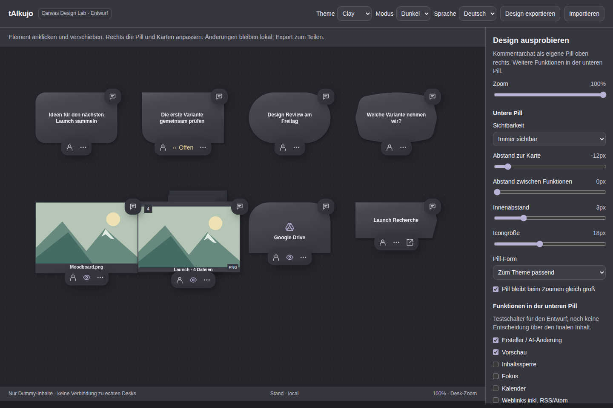

# tAIkujo · Canvas Design Lab

**[Open the live playground](https://mbd02.github.io/taikujo-canvas-design/)**

A standalone design draft with dummy elements, a separate top-right comment
chat pill on every card and a lower pill for the remaining actions.
Original app SVG outlines and starting dimensions, including the task contour,
rounded decision, capsule event, tunnel arch, flat Desk ribbon and square files.
Five material themes, light/dark mode, DE/EN, zoom, movable cards and editable
pill spacing/actions. Export/import JSON to share a design configuration.

Reload the same live link after a published change. The revision appears in the
footer. Each new revision starts from the published design; settings saved for
an older revision cannot obscure the updated defaults. Settings remain local
to the browser. Export before switching revisions if you want to keep them.

This repository contains only the dummy page, screenshot and publication metadata.
No real Desks, files, accounts, API/MCP requests or application backend.
Published by GitHub Pages from `main` / root; `.nojekyll` avoids Jekyll processing.

